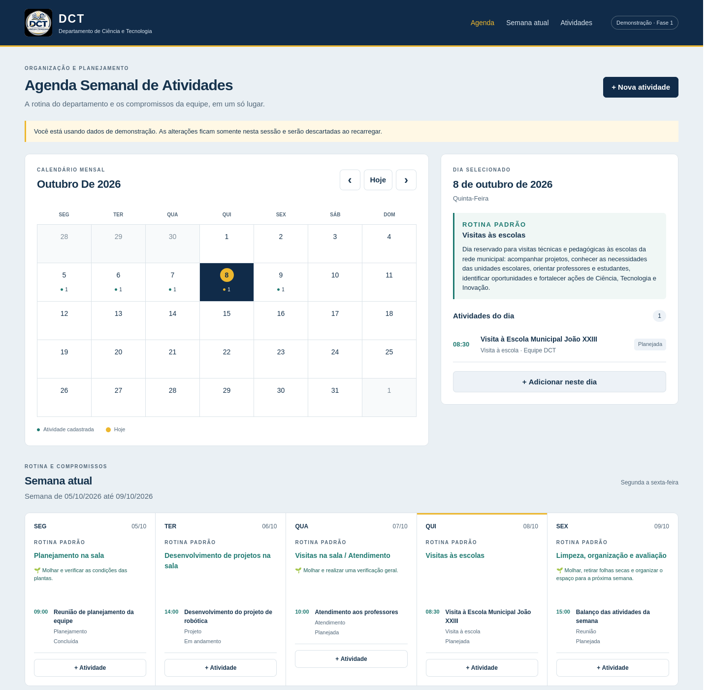

# Agenda Semanal de Atividades – DCT

Agenda interna do Departamento de Ciência e Tecnologia para organizar a rotina e os compromissos da equipe.

## Implementação atual — Fase 1

Interface em HTML5, CSS3 e JavaScript ES Modules, sem framework e sem dependências de runtime.

- Calendário mensal com navegação, retorno para hoje e indicadores de atividades.
- Seleção de data com rotina padrão, descrição e cuidado com as plantas.
- Semana atual de segunda a sexta, com rotina e compromissos separados visualmente.
- Cadastro e edição em modal, alteração de status e exclusão com confirmação.
- Validação de título, data, categoria, status e horários.
- Mensagens de feedback, estados vazios e layout responsivo.
- Datas no padrão brasileiro e referência do dia atual no fuso `America/Manaus`.

**Dados de demonstração:** os exemplos acompanham a semana atual. Alterações existem apenas na memória desta sessão; recarregar a página restaura os exemplos. Não use esta fase para armazenar informações reais. Não há autenticação nesta fase.

A implementação segue a instrução das seções 58 e 59 do [ROBOT.md](./ROBOT.md): concluir e validar a interface antes de integrar Supabase. Login, persistência, RLS, filtros, pesquisa e PDF pertencem às fases seguintes.

## Prévia



## Identidade visual

Paleta conferida em `painel_digital/style.css` e `PontoApp/src/styles.css`:

| Uso | Cor |
| --- | --- |
| Azul institucional | `#102b49` |
| Texto principal | `#16334d` |
| Verde | `#1d7970` |
| Amarelo institucional | `#edb72e` |
| Fundo | `#eaf0f4` |
| Texto secundário | `#526779` |
| Bordas | `#dbe3e9` |

As cores estão centralizadas em CSS variables. O logo foi reutilizado do Painel DCT.

## Executar localmente

Com Python 3 disponível:

```sh
python3 -m http.server 8080 --bind 127.0.0.1
```

Abra `http://localhost:8080`. Alternativamente, use `npm start` ou o Live Server do editor. É necessário servir por HTTP, pois o navegador restringe módulos ao abrir `index.html` diretamente por `file://`.

Com Node.js 20 ou superior, execute os testes de lógica:

```sh
npm test
```

Não é necessário executar `npm install`.

## Estrutura

```text
index.html
css/
  style.css          Identidade e componentes
  calendar.css       Calendário mensal
  responsive.css     Adaptações para tablet e celular
js/
  dates.js           Datas locais, calendário e semana útil
  weeklyRoutine.js   Rotina fixa, independente das atividades
  activities.js      Dados de demonstração, opções e validação
  calendar.js        Renderização do calendário
  views.js           Visualizações diária, semanal e mensal
  ui.js              Elementos seguros e mensagens
  modal.js           Formulário e confirmação de exclusão
  app.js             Estado e coordenação da interface
assets/images/       Logo DCT
tests/               Testes de datas e regras de cadastro
```

## GitHub Pages

A demonstração pode ser compartilhada para avaliação da equipe. Não há login: quem tiver acesso à URL poderá visualizar a interface. Os exemplos são fictícios e alterações de um visitante não são salvas nem compartilhadas com outros visitantes.

Para publicar:

1. Envie os arquivos do projeto para o repositório no GitHub.
2. Em **Settings → Pages → Build and deployment**, escolha **Deploy from a branch**.
3. Selecione a branch que recebeu os arquivos e a pasta **/ (root)**; clique em **Save**.
4. Aguarde o deploy terminar e abra o endereço informado pelo GitHub.

Não há etapa de build. O arquivo `.nojekyll` permite servir os arquivos estáticos diretamente. Todos os recursos usam caminhos relativos para funcionar também em subdiretórios.

Referência: [configuração da origem de publicação do GitHub Pages](https://docs.github.com/en/pages/getting-started-with-github-pages/configuring-a-publishing-source-for-your-github-pages-site).

## Próximas fases e segurança

A integração posterior deve trocar o armazenamento em memória pelo Supabase, configurar a tabela `activities`, implementar Auth e proteger os dados com RLS para usuários autorizados. Somente a URL e a chave pública do projeto poderão existir no frontend; nunca incluir `service_role`.

Entradas atuais são renderizadas com `textContent`, sem interpolar conteúdo do usuário em HTML. A rotina semanal permanece em configuração fixa e não é duplicada no banco.

## Validação manual

1. Navegue entre meses, incluindo dezembro/janeiro, e retorne usando Hoje.
2. Selecione dias úteis e fins de semana e confira a rotina exibida.
3. Cadastre com e sem horário; tente título em branco e horário final anterior ao inicial.
4. Edite título, data e status; confira calendário, dia, semana e listagem.
5. Cancele e confirme uma exclusão.
6. Navegue por teclado, feche o modal com Escape e confira a interface em celular.
7. Recarregue a página e confirme o retorno dos dados de demonstração.

Nenhuma licença de distribuição foi definida pelo responsável pelo projeto.
